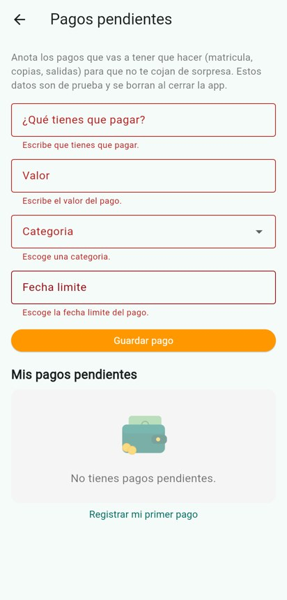
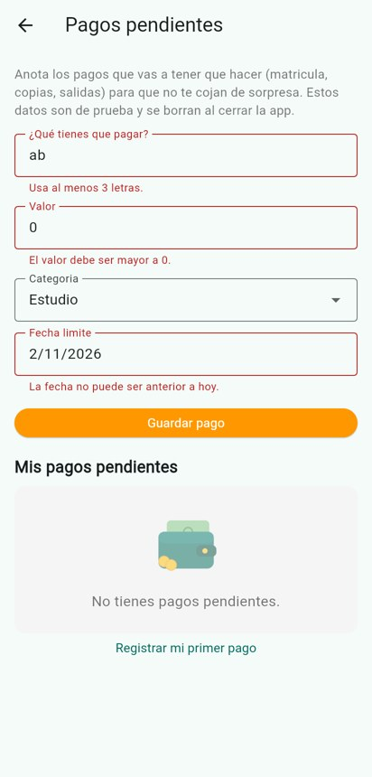
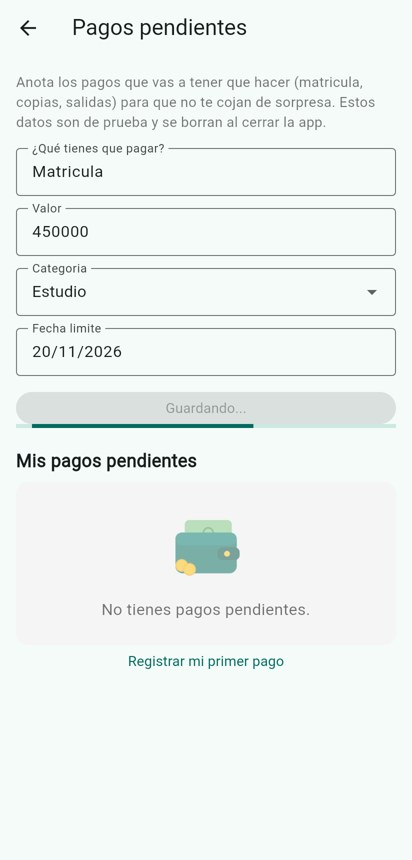
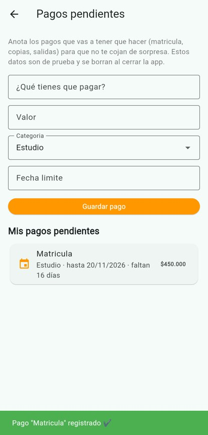
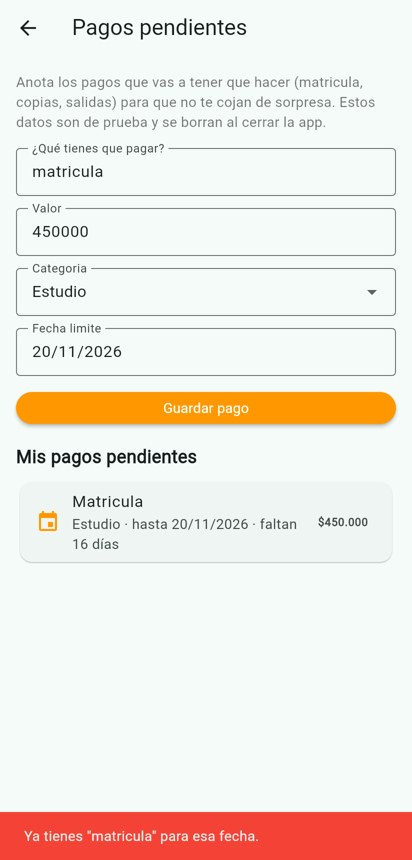
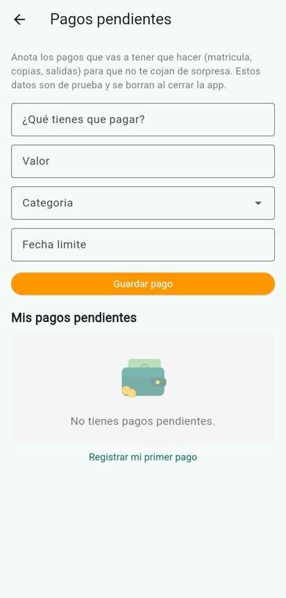

# Mi Bolsillo 💰

App movil hecha en Flutter para el curso **ET0126 · Programación de Dispositivos Móviles** de la I.U. Pascual Bravo.

**Entregas en este repositorio:**
- **Taller Flutter 1** (inicio de la app): ver el tag [`taller-1`](../../tree/taller-1).
- **Taller de continuación** (formularios y servicio en memoria): ver la sección [Taller de continuación](#taller-de-continuación-pagos-pendientes) y el tag [`taller-2`](../../tree/taller-2).

## Propuesta de la app

Mi app se llama **Mi Bolsillo**. Está dirigida a **estudiantes universitarios que manejan poca plata al mes** (lo que les dan en la casa o lo que ganan en un trabajo de medio tiempo), quien necesita **saber en que se le va el dinero y no quedarse sin plata antes de que termine el mes**. La app le ayudará a **controlar sus gastos y no pasarse de su presupuesto** mediante **el registro de cada gasto con su categoria, una lista con todos los gastos y un anillo dibujado que muestra cuanto del presupuesto ya se gastó**.

- **Nombre de la app:** Mi Bolsillo
- **Usuario:** estudiantes de la universidad que tienen un presupuesto pequeño para transporte, comida, fotocopias, etc.
- **Problema:** muchas veces uno gasta "de a poquito" (un tinto, un pasaje, unas copias) y al final del mes no sabe en que se fue la plata y ya no le alcanza.
- **Solución:** la app deja anotar cada gasto rapido, muestra el total gastado contra el presupuesto del mes y avisa con colores cuando uno ya se esta acercando al limite.

### Funciones iniciales

1. Registrar un gasto con descripción, valor y categoria (Comida, Transporte, Estudio, Ocio, Otros).
2. Ver la lista de gastos y filtrarla por categoria (y borrar un gasto si me equivoque).
3. Definir el presupuesto del mes y ver en un anillo (Canvas) cuanto se ha gastado y cuantos dias le alcanza la plata que queda.

### Recorrido principal

1. El usuario abre la app y ve el nombre, una descripción corta y el anillo con su presupuesto.
2. Toca el botón **"Agregar gasto"**.
3. Escribe la descripción y el valor, escoge la categoria y toca **Guardar** (si falta algo o el valor no es valido la app le avisa).
4. Vuelve a la pantalla inicial, sale un mensaje de confirmación y el gasto aparece en la lista; el anillo y el resumen por categoria se actualizan.
5. Si quiere, filtra la lista por categoria o cambia su presupuesto con el botón del lapiz.

### Datos que guarda la app

- La lista de gastos: descripción, valor, categoria, fecha y una nota opcional.
- El presupuesto del mes (un número).

### Canvas

Con `CustomPainter` dibujo un **anillo de avance** que muestra el porcentaje del presupuesto que ya se gastó. El anillo cambia de color: verde si va bien, naranja si ya se gasto mas del 70% y rojo si se paso del presupuesto. Así el usuario entiende de un vistazo como va sin tener que hacer cuentas.

### ¿Por qué SharedPreferences y no SQLite?

Escogi **SharedPreferences** porque los datos de esta primera versión son pocos y sencillos: un número (el presupuesto) y una lista de gastos que guardo como texto JSON. Un estudiante no registra miles de gastos al mes, entonces no necesito hacer consultas complicadas ni tablas. Si mas adelante la app crece (por ejemplo, historial de varios meses o reportes) pensaria en cambiar a SQLite.

## Capturas

| Pantalla inicial | Filtro por categoria |
|---|---|
|  |  |

## Como ejecutar la app

1. Tener instalado Flutter (yo use la versión 3.47) y un emulador Android o un celular con depuración USB.
2. Clonar el repositorio:
   ```bash
   git clone https://github.com/santiagohg17/et0126-mi-bolsillo.git
   cd et0126-mi-bolsillo
   ```
3. Descargar los paquetes:
   ```bash
   flutter pub get
   ```
4. Correr la app (con el emulador abierto o el celular conectado):
   ```bash
   flutter run
   ```
5. Para correr las pruebas: `flutter test`

Paquete que use: [`shared_preferences`](https://pub.dev/packages/shared_preferences) para guardar los datos en el celular.

## Estructura del proyecto

```
lib/
  main.dart                      -> arranca la app (MaterialApp)
  models/
    gasto.dart                   -> clase Gasto (el dato central de la app)
  screens/
    home_screen.dart             -> pantalla principal (StatefulWidget)
    agregar_gasto_screen.dart    -> formulario para agregar un gasto
  widgets/
    encabezado_app.dart          -> nombre, imagen y descripción (StatelessWidget)
    gasto_card.dart              -> tarjeta de cada gasto en la lista
    lista_vacia.dart             -> mensaje cuando no hay gastos
    anillo_presupuesto.dart      -> anillo dibujado con Canvas (CustomPainter)
  services/
    gastos_service.dart          -> guardar/leer con SharedPreferences y calculos
    validaciones.dart            -> funciones que validan el formulario
assets/
  images/billetera.png           -> imagen local de la app
```

## Requisitos de Flutter y donde estan

| Requisito | Donde esta |
|---|---|
| MaterialApp, Scaffold y AppBar | `main.dart` y `home_screen.dart` |
| Padding, Row, Column, Card, Container, SizedBox, Text, Icon, botones | `home_screen.dart`, `gasto_card.dart`, `lista_vacia.dart` |
| Widgets sin estado | `EncabezadoApp`, `GastoCard`, `ListaVacia`, `AnilloPresupuesto` |
| StatefulWidget + setState | `HomeScreen` (agregar, borrar, filtrar, cambiar presupuesto) y `AgregarGastoScreen` (categoria) |
| Formulario con validación | `agregar_gasto_screen.dart` usa `validarDescripcion` y `validarValor`; el presupuesto tambien se valida |
| Lista de registros | `_listaDeGastos()` en `home_screen.dart` |
| Respuesta cuando no hay registros | widget `ListaVacia` |
| Respuesta al completar la acción | `SnackBar` verde "Gasto guardado ✔" |
| Control interactivo | `ChoiceChip` para filtrar por categoria, botón borrar y botón de editar presupuesto |
| Canvas | `AnilloPainter` en `anillo_presupuesto.dart` |
| Datos que persisten | `gastos_service.dart` con SharedPreferences |
| Imagen local | `assets/images/billetera.png` registrada en `pubspec.yaml` |

## Conceptos de Dart en mi app

| Concepto | Donde se ve |
|---|---|
| Tipos, `final`, `const` y null safety | `models/gasto.dart`: todos los atributos son `final` y con tipo; solo `nota` es `String?` porque es opcional. Las categorias son `const` en `gastos_service.dart` |
| Clases y objetos | Clase `Gasto` con atributos, constructor, `fromMap` y metodos `valorEnPesos()`, `esGastoGrande()`, `fechaCorta()`. Los objetos se crean en `_guardar()` de `agregar_gasto_screen.dart` |
| Funciones | `validarDescripcion`, `validarValor` y `convertirValor` en `services/validaciones.dart`; `formatearPesos` en `gasto.dart` |
| List | `List<Gasto> _gastos` en `home_screen.dart` y `cargarGastos()` en el servicio |
| Set | `categoriasUsadas()` en `gastos_service.dart`: un `Set<String>` con las categorias que tienen gastos, para que los chips de filtro no salgan repetidos |
| Map | `resumenPorCategoria()` devuelve un `Map<String, double>` con el total por categoria. Tambien `iconosCategoria` en `gasto_card.dart` |
| if y for | `if` para el color del anillo (`colorSegunAvance`) y los mensajes; `for` para sumar el total, armar el resumen y filtrar la lista |
| while | `diasQueAlcanza()` en `gastos_service.dart`: va restando el promedio diario a la plata que queda para contar cuantos dias alcanza. Es finito porque para cuando ya no alcanza o llega a 31 dias, y no bloquea la interfaz |

## Pruebas

En `test/widget_test.dart` hay pruebas sencillas del formato de pesos, las validaciones y el resumen por categoria. Probé la app en el navegador: agregué un gasto, salió el mensaje de confirmación, cerré y volví a abrir y el gasto seguia guardado.

## Uso de inteligencia artificial

Si utilice una herramienta de IA (Claude). Me ayudó a escoger la idea, a armar la estructura de carpetas y a escribir gran parte del código de esta primera versión (el modelo, el servicio con SharedPreferences, las pantallas y el `CustomPainter` del anillo), ademas del README. Yo revisé el código linea por linea, lo ejecuté y probé el recorrido, y lo estudié para poder explicarlo y modificarlo en vivo.

---

# Taller de continuación: pagos pendientes

## ¿Para qué sirve este flujo?

Sigue siendo la misma app Mi Bolsillo. Ademas de los gastos que ya hice, un estudiante muchas veces tiene **pagos que vienen** y que se le olvidan: la matricula, las copias de un parcial, una salida de campo. Si los anota antes, puede guardar esa plata y no quedarse corto. Por eso agregue la pantalla **Pagos pendientes**, que se abre con el botón naranja de la pantalla principal.

## Campos y validaciones

| Campo | Control | Validación |
|---|---|---|
| ¿Qué tienes que pagar? | Texto | `MultiValidator` con `RequiredValidator`, `MinLengthValidator(3)` y `MaxLengthValidator(40)` |
| Valor | Número | `MultiValidator` con `RequiredValidator` y `PatternValidator` (solo números) + **regla propia**: debe ser mayor a 0 |
| Categoria | Lista desplegable | `RequiredValidator` (obligatorio escoger una) |
| Fecha limite | Selector de fecha | **Regla propia**: obligatoria y **no puede ser anterior a hoy** |

Todas las reglas estan en `lib/services/validaciones.dart`. El botón Guardar llama a `_formKey.currentState!.validate()` y si algo esta mal **no se llama al servicio**.

## Modelo y servicio

- **Modelo** `lib/models/pago_pendiente.dart`: clase `PagoPendiente` con `id`, `descripcion`, `valor`, `categoria` y `fechaLimite`, todos con tipo. Tiene los metodos `diasQueFaltan()`, `esIgualA()`, `valorEnPesos()` y `fechaCorta()`.
- **Servicio** `lib/services/pagos_service.dart`: simula una API.
  - `listar()` espera 500 ms con `Future.delayed` y devuelve una lista que no se puede modificar.
  - `crear()` espera 1,2 segundos, revisa la regla de negocio y guarda el pago.
  - La lista `_pagos` es **privada**, la pantalla no la puede cambiar directamente.
- **Regla de negocio:** no se puede registrar dos veces el mismo pago (misma descripción, sin importar mayusculas, y misma fecha limite). Si pasa, el servicio lanza un `StateError` y la pantalla muestra el mensaje en rojo sin perder lo escrito.
- **Pantalla** `lib/screens/pagos_pendientes_screen.dart` (StatefulWidget): tiene la `GlobalKey<FormState>`, los controladores, la lista y las banderas `_cargandoLista` y `_guardando`. La lista se pide en `initState()`, el guardado usa `try / on StateError / finally` y se revisa `mounted` despues de cada `await`. Los controladores se liberan en `dispose()`.
- **Widget** `lib/widgets/pago_card.dart` (StatelessWidget): solo muestra un pago.

## Límite de los datos en memoria

Los **pagos pendientes son temporales**: viven en una lista en la memoria de la app, entonces **al cerrar y abrir la app se borran**. Esto es a proposito porque el servicio solo simula una API, no es una base de datos.
Los **gastos y el presupuesto** del Taller 1 **siguen guardados con SharedPreferences** y no se pierden.

## Pruebas manuales

Las hice en el navegador (Chrome) con tamaño de celular:

| Caso | Acción | Resultado |
|---|---|---|
| Campos vacíos | Toqué Guardar sin escribir | ✅ Salen los 4 errores y no se agrega nada |
| Texto muy corto | Escribí "ab" | ✅ Sale "Usa al menos 3 letras." |
| Regla de dominio | Valor 0 y fecha del 2/11/2026 (ya paso) | ✅ Salen "El valor debe ser mayor a 0." y "La fecha no puede ser anterior a hoy." |
| Registro válido | Matricula, 450000, Estudio, 20/11/2026 | ✅ El botón cambia a "Guardando...", sale la barra de progreso, luego el mensaje verde y el pago en la lista |
| Error de negocio | Volví a guardar "matricula" con la misma fecha | ✅ Sale en rojo "Ya tienes "matricula" para esa fecha." y no se duplica; lo escrito se queda |
| Envío rápido | Toqué Guardar 5 veces seguidas | ✅ Solo se creó un pago ("Copias del parcial") |
| Reinicio | Cerré y abrí la app | ✅ Los gastos y el anillo siguen igual; los pagos pendientes quedan vacíos (es lo esperado) |

Tambien hay pruebas automaticas en `test/pagos_test.dart` (validadores y regla de duplicados). Se corren con `flutter test`.

## Capturas del taller de continuación

| Campos vacíos | Texto corto y reglas | Guardando |
|---|---|---|
|  |  |  |

| Guardado correcto | Error duplicado | Después de reiniciar |
|---|---|---|
|  |  |  |

## Uso de IA en este taller

Use Claude otra vez. Me ayudó a escoger la función de pagos pendientes, a escribir el modelo, el servicio, la pantalla y las validaciones con `form_field_validator`, y a probar los casos. En las pruebas encontramos un error: `RequiredValidator` se rompe cuando la lista de categorias manda `null`, por eso hice la función `validarCategoriaPago` que le pasa `''`. Revisé y probé todo el código y lo puedo explicar.
